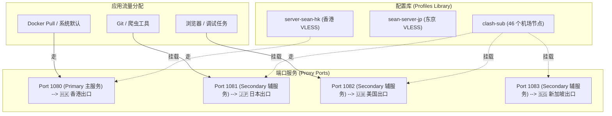

# pnode 客户端完整使用与多端口管理指南

`pnode`（别名 `proxy-node`）是基于 [sing-box](https://sing-box.sagernet.org) 内核开发的终端多端口代理管理工具。它统一了**主端口常驻服务**、**辅端口动态拓扑**、**Clash 订阅解析**、**VLESS+Reality 节点管理**以及 **Docker 代理策略**。

---

## 目录
- [一、核心架构与前置端口规则](#一核心架构与前置端口规则)
- [二、节点切换详解（以 1081 端口为例）](#二节点切换详解以-1081-端口为例)
- [三、Clash 订阅与多端口分流实战](#三clash-订阅与多端口分流实战)
- [四、Profile 配置库（自建 VPS 与节点管理）](#四profile-配置库自建-vps-与节点管理)
- [五、Docker 代理管理（3 态隔离机制）](#五docker-代理管理3-态隔离机制)
- [六、终端 Shell 代理与单次免配置执行](#六终端-shell-代理与单次免配置执行)
- [七、常用操作命令速查表（CheatSheet）](#七常用操作命令速查表cheatsheet)

---

## 一、核心架构与前置端口规则

### 1. 架构设计原理


- **主端口（1080）**：系统常驻服务 `sing-box-client.service`，开机自启，同时作为系统环境与 Docker 镜像加速的默认代理端点。
- **辅端口（1081, 1082...）**：由 systemd 模板服务 `sing-box-port@<port>.service` 托管，按需创建与销毁，互不干扰。
- **Profile 配置库**：保存在 `/etc/sing-box-client/profiles/`。节点和订阅即使未在任何端口运行，也会持久化保存在库中。

### 2. 前置端口语法规则（Front-Loaded Port Rule）
所有 `pnode` 命令均遵循统一的语法风格：
```bash
pnode [端口] <操作> [参数...]
```
- **省略端口**：默认操作 **1080 主端口**（例如：`pnode ls`、`pnode use 1`、`pnode 日本`）。
- **显式指定端口**：对指定端口执行完全对称的操作（例如：`pnode 1081 ls`、`pnode 1081 use 1`、`pnode 1081 23`、`pnode 1081 美国`）。

---

## 二、节点切换详解（以 1081 端口为例）

对于加载了订阅（如包含几十个节点的 `clash-sub`）的端口，`pnode` 提供了 3 种极简的节点热切换方式：

### 1. 方式一：按节点序号直接切换（最快速）
先运行 `pnode 1081 ls` 查看节点列表，然后直接跟上序号：
```bash
# 切换到 #1 节点 (例如：香港Z01)
pnode 1081 1

# 切换到 #23 节点 (例如：新加坡Z01 | IEPL)
pnode 1081 23

# 切换到 #27 节点 (例如：美国Z01 | IEPL)
pnode 1081 27
```

### 2. 方式二：按关键词/国家模糊搜索切换（最方便）
不需要记忆编号，直接输入国家或地区名称：
```bash
# 切换到日本节点
pnode 1081 日本

# 切换到香港节点
pnode 1081 香港

# 切换到新加坡节点
pnode 1081 新加坡

# 切换到美国节点
pnode 1081 美国
```

### 3. 方式三：交互式数字菜单切换
如果不确定选哪个，可以调用交互菜单：
```bash
pnode 1081 switch
```
终端会列出所有可用节点，输入序号回车即可生效。

### 4. 切换后验证
```bash
# 查看当前 1081 正在生效的节点名称：
pnode 1081 current

# 测速并查看 1081 真实的公网出口 IP 与握手延迟：
pnode 1081 test
```

---

## 三、Clash 订阅与多端口分流实战

**场景需求**：只买了一份机场订阅，希望同时开出多个端口，让不同进程/容器走不同国家节点。

### 实战步骤

#### 步骤 1：导入订阅到配置库
```bash
pnode profile add clash-sub "https://crah6.no-mad-world.club/link/xxxx?clash=3&extend=1"
```

#### 步骤 2：分配端口并挂载配置
```bash
# 将 1081、1082、1083 端口都挂载上 clash-sub 配置：
pnode 1081 use clash-sub
pnode 1082 use clash-sub
pnode 1083 use clash-sub

# 或者使用自动分配端口命令：
pnode add clash-sub   # 自动寻找下一个未占用端口（如 1084）并启动
```

#### 步骤 3：为各个端口独立分配出口地区
```bash
pnode 1081 日本
pnode 1082 美国
pnode 1083 新加坡
```

#### 步骤 4：查看所有端口状态看板
运行 `pnode dashboard`（或直接输入 `pnode`）：
```text
=== Proxy Ports Dashboard ===
------------------------------------------------------------------------------------
 Port     Profile            Status       Active Node                Nodes    Type
------------------------------------------------------------------------------------
 1080     server-sean-hk     RUNNING      server-sean-hk             1        Primary
 1081     clash-sub          RUNNING      🇯🇵 日本Z01 | IEPL            46       Secondary
 1082     clash-sub          RUNNING      🇺🇲 美国Z01 | IEPL | x1.5     46       Secondary
 1083     clash-sub          RUNNING      🇸🇬 新加坡Z01 | IEPL | x2      46       Secondary
------------------------------------------------------------------------------------
```

#### 步骤 5：并发连通性测试
```bash
# 一键并发测试所有运行端口的健康状态、出口 IP 与延迟：
pnode test
```

#### 步骤 6：更新订阅节点
当机场节点域名或 IP 发生变更时：
```bash
pnode update clash-sub
```
> [!NOTE]
> `pnode update` 会重新拉取最新节点并平滑重启相关端口实例，原有端口配置的地区会尽量自动保持。

---

## 四、Profile 配置库（自建 VPS 与节点管理）

### 1. 查看库中所有已配置的 Profile
```bash
pnode profiles      # 简写: pnode p
```
输出说明：
- **Status 显示端口号**：表示正在该端口上运行。
- **Status 为空**：表示离线保存在配置库中，随取随用。

### 2. 添加与删除 Profile
```bash
# 从 VLESS+Reality 链接导入自建节点：
pnode profile add sean-server-jp "vless://uuid@ip:443?security=reality&...#server-sean-tokyo"

# 保存当前 1080 端口的配置为一个具名 Profile：
pnode profile save backup-2026

# 删除指定的 Profile（按名称或序号）：
pnode profile del 3
pnode profile del old-profile
```

### 3. 主端口快速切换 Profile
```bash
# 将 1080 主端口切换为日本节点：
pnode use sean-server-jp
# 或按序号：
pnode use 2
```

### 4. 释放与停止辅端口
```bash
# 停止并删除指定端口实例（如释放 1084）：
pnode 1084 stop

# 停止所有辅端口（只保留 1080 主端口）：
pnode stop all
```

---

## 五、Docker 代理管理（3 态隔离机制）

```bash
# 查看当前 Docker 代理模式
pnode docker status
```

`pnode` 提供了专为 Docker 设计的三态隔离机制：

| 模式 | 命令 | 说明 | 适用场景 |
| :--- | :--- | :--- | :--- |
| **Pull-Only** *(推荐)* | `pnode docker pull` | **仅拉取镜像走代理**，容器内部默认直连 | 避免后台数据库或离线容器意外耗尽代理流量 |
| **Global** | `pnode docker all` | **镜像拉取 + 所有容器默认走代理** | 需要所有容器开箱即能访问外网的场景 |
| **Disabled** | `pnode docker off` | **彻底关闭 Docker 代理** | 本机处于境外或不需要加速时 |

### 容器内按需使用代理
在 **Pull-Only** 模式下，个别容器需要走代理时：
1. **Docker Run 命令行注入**：
   ```bash
   docker run -e HTTP_PROXY=http://172.17.0.1:1080 -e HTTPS_PROXY=http://172.17.0.1:1080 my-image
   ```
2. **Docker Compose 文件引用**：
   ```yaml
   services:
     web:
       image: my-service
       environment:
         - HTTP_PROXY=http://172.17.0.1:1080
         - HTTPS_PROXY=http://172.17.0.1:1080
   ```
3. **测试容器连通性**：
   ```bash
   pnode docker test
   ```

---

## 六、终端 Shell 代理与单次免配置执行

### 1. 终端环境变量快捷开关（`proxy` 函数）
```bash
# 开启当前终端代理（默认 1080）：
proxy on

# 开启当前终端代理并指定端口（例如指定 1081 日本）：
proxy on 1081

# 查看当前终端代理状态：
proxy status

# 测试当前终端代理连通性：
proxy test

# 关闭当前终端代理：
proxy off
```

### 2. 单次命令代理（不修改环境变量）
使用 `pnode [port] run <command>`，只对紧随其后的单条命令注入代理：
```bash
# 通过 1080 下载：
pnode run curl -O https://example.com/file.tar.gz

# 通过 1081（日本）执行 git clone：
pnode 1081 run git clone https://github.com/my/repo.git

# 通过 1082（美国）查询公网出口：
pnode 1082 run curl ipinfo.io
```

---

## 七、常用操作命令速查表（CheatSheet）

```bash
# ========== 看板与连通性 ==========
pnode                     # 查看端口仪表板 (多端口运行时) 或 1080 节点列表
pnode dashboard           # 强制展示所有活跃端口运行看板
pnode test                # 全端口并发测试延迟与公网 IP
pnode 1081 test           # 仅测试 1081 端口
pnode 1081 current        # 查看 1081 当前生效节点名
pnode 1081 ls             # 列出 1081 端口可用的所有节点

# ========== 节点切换 (支持序号与中文模糊搜索) ==========
pnode 2                   # 将 1080 切到节点 #2
pnode 日本                # 将 1080 切到含“日本”的节点
pnode 1081 3              # 将 1081 切到节点 #3
pnode 1081 香港           # 将 1081 切到含“香港”的节点
pnode 1081 switch         # 交互式菜单切换 1081 节点

# ========== 端口管理 ==========
pnode add clash-sub       # 自动分配下一个空闲端口并挂载 clash-sub
pnode 1082 use clash-sub  # 将 1082 端口绑定为 clash-sub 配置
pnode 1084 stop           # 停止并销毁 1084 端口服务
pnode stop all            # 停止所有次级辅端口 (保留 1080)

# ========== 配置库管理 ==========
pnode profiles            # 查看所有已保存的 Profile (简写: pnode p)
pnode use <#|name>        # 切换 1080 使用指定 Profile (如: pnode use sean-server-jp)
pnode update clash-sub    # 更新指定订阅节点
pnode profile del <#|name># 删除 Profile

# ========== Docker 与终端 ==========
pnode docker pull         # 设置 Docker 为仅镜像拉取加速模式
pnode docker all          # 设置 Docker 为全局代理模式
pnode docker test         # 测试容器内网络
proxy on 1081             # 当前终端切换走 1081 代理
proxy off                 # 关闭当前终端代理
```
